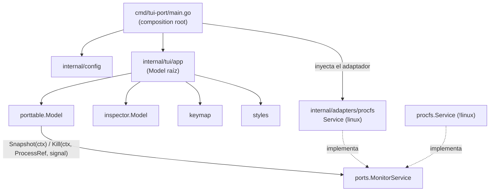

# tui-port

TUI en Go, multiplataforma y de bajo consumo, centrada en la red del host: lista
los puertos ocupados, el proceso que los posee, su memoria residente y permite
terminarlo con una tecla. El estilo es el de `htop`, pero la unidad de trabajo no
es el proceso sino el socket.

Estado actual: **v0.1.1**. Release de seguridad: tabla de puertos, detalle del
socket y del proceso, pestañas, orden y filtro, señales con guardas e identidad
verificada, saneamiento de la salida, temas y configuración JSON, adaptador
Linux sobre `/proc` y stub para el resto de sistemas.

## Por qué

`htop` ordena por CPU y memoria; los puertos quedan escondidos en `ss`, `lsof`,
`netstat` o `fuser`. `tui-port` responde a la pregunta "¿quién tiene este
puerto?" sin cambiar de herramienta: cada fila es un socket del kernel, la
columna de proceso es su dueño y el panel de detalle concentra el resto
(usuario, ppid, RSS, hilos, hora de arranque, cmdline y todos los puertos de ese
proceso). Desde ahí, `x` o `t` cierran el proceso.

## Features

- **Tabla de puertos:** una fila por socket con `PROTO`, `ENDPOINT`, `ESTADO`,
  `PROCESO` y `RSS`. El endpoint usa `*` para el comodín y corchetes para IPv6;
  cuando no cabe, se recorta por la izquierda para no perder el puerto.
- **Pestañas:** `Listen`, `Conectadas` y `Todas` filtran el mismo snapshot por
  actividad (`listen`, con peer, o todo), sin volver a leer `/proc`.
- **Orden con `s`:** ciclo `puerto` → `rss` → `proceso` → `pid`, con
  desempates estables por puerto, protocolo e inode.
- **Filtro en vivo con `/`:** busca por puerto, proceso, pid, protocolo,
  endpoint, estado y usuario, sin distinguir mayúsculas. `enter` conserva el
  texto, `esc` lo limpia.
- **Detalle:** sección `socket` (proto, local, remoto, estado, uid, inode),
  sección `proceso` (nombre, usuario, ppid, RSS, hilos, inicio con antigüedad y
  cmdline ajustada) y la lista completa de puertos del proceso, con el socket
  seleccionado marcado.
- **Señales con una tecla:** `x` envía `SIGKILL` y `t` envía `SIGTERM`. El
  monitor rechaza `pid <= 0`, `pid 1` y su propio pid, exige que el socket tenga
  un proceso resuelto y vuelve a comprobar el `starttime` del kernel antes de
  cada señal, así que un PID reciclado no recibe el disparo.
- **Salida saneada:** los nombres, usuarios, cmdlines, filtros, rutas y errores
  que vienen de `/proc` o de la configuración se neutralizan antes de
  renderizarse; una secuencia de control no llega a la terminal.
- **Teclado y ratón:** clic para seleccionar fila, pestañas y botón del detalle
  clicables, rueda sobre el panel bajo el cursor y arrastre del borde compartido
  para repartir el ancho.
- **Cuatro temas:** Tokyo Night (default), Catppuccin Mocha, Dracula y Gruvbox
  Dark, aplicados a chrome, estados y avisos.
- **Configuración JSON:** tema, ancho de la tabla, detalle minimizado y
  overrides de teclas, con `--print-config` e `--init-config`.
- **Refresco de 1 s:** ticker permanente con una sola lectura en vuelo; una
  respuesta tardía se descarta y un fallo conserva el último snapshot bueno.
- **Escaneos acotados:** límites de dominio para sockets, procesos, descriptores
  por proceso, cmdline y tamaño de cada tabla de `/proc/net`.

## Permisos: la parte que importa

Las tablas `/proc/net/{tcp,tcp6,udp,udp6}` son legibles por cualquier usuario,
así que la lista de sockets se ve completa. Lo que **no** es libre es la
atribución: leer `/proc/<pid>/fd` para resolver el inode del socket solo está
permitido para procesos propios (o con la capacidad `CAP_SYS_PTRACE`/root, que
es la misma comprobación del kernel).

| Ejecución | Qué se ve |
| :--- | :--- |
| `./tui-port` (usuario normal) | Todos los sockets; solo los procesos del usuario quedan atribuidos |
| `sudo ./tui-port` | Todos los sockets y todos los procesos atribuidos |
| Binario con `CAP_SYS_PTRACE` | Igual que root para la atribución, sin ser root |

Los sockets sin dueño resuelto aparecen con `?` en `PROCESO`, `-` en `RSS` y,
en el detalle, con el aviso `uid N · ejecuta como root para ver todos los
procesos`.

Dentro de un contenedor el binario solo ve el espacio de nombres de red y de
procesos del contenedor. El perfil `host` de Compose comparte ambos con el host
(`network_mode: host` y `pid: host`) y sirve para probar la imagen, pero la vía
recomendada para uso real es ejecutar el binario en el host.

## Plataforma

| Sistema | Estado |
| :--- | :--- |
| Linux | Soportado: adaptador sobre `/proc` |
| macOS, Windows y cualquier sistema no Linux | Compila y arranca, pero la tabla muestra `sistema no soportado` (`domain.ErrUnsupported`) |

El adaptador de otros sistemas no falla al construirse: implementa el puerto y
devuelve el error de dominio en cada lectura, así que el cableado de la TUI no
necesita build tags propios. `.goreleaser.yaml` define los binarios para linux,
darwin y windows en amd64 y arm64.

## Stack

| Componente | Versión | Import |
| :--- | :--- | :--- |
| Go | 1.27.4 | — |
| Bubble Tea | v2.1.2 | `charm.land/bubbletea/v2` |
| Lip Gloss | v2.1.1 | `charm.land/lipgloss/v2` |
| Bubbles | v2.2.1 | `charm.land/bubbles/v2` |
| GoReleaser (release) | v2.20.2 | — |
| Air (hot reload) | v1.67.4 | — |
| Alpine (imagen de runtime) | 3.24.4 | — |

Las dependencias usan los paths canónicos v2 (`charm.land/...`), no los antiguos
`github.com/charmbracelet/...`. `.goreleaser.yaml` usa el esquema `version: 2` y
el workflow de release fija GoReleaser v2.20.2.

## Estructura del proyecto

```
tui-port/
├── .github/workflows/        # ci.yml (test + vet) y release.yml (tags v*)
├── cmd/tui-port/             # composition root: flags, cableado y arranque
├── internal/
│   ├── adapters/procfs/      # adaptador Linux sobre /proc + stub !linux
│   ├── config/               # flags, env, archivo JSON y escritura atómica
│   ├── domain/               # socket, proceso, snapshot, límites y errores
│   ├── ports/                # puerto MonitorService
│   └── tui/
│       ├── app/              # modelo raíz, pestañas, layout, foco y ratón
│       ├── components/       # porttable e inspector
│       ├── keymap/           # catálogo, parser de teclas y overrides
│       ├── styles/           # catálogo de temas y tokens Lip Gloss
│       └── textsafe/         # neutraliza controles y formato antes de renderizar
├── scripts/                  # install.sh (Linux/macOS) e install.ps1 (Windows)
├── .air.toml
├── .goreleaser.yaml
├── CHANGELOG.md
├── CONTRIBUTING.md
├── Dockerfile
├── LICENSE
├── Makefile
├── README.md
├── SECURITY.md
├── compose.yaml
├── config.example.json
├── go.mod
└── go.sum
```

`bin/` y `tmp/` son artefactos locales (binario y Air) y están en `.gitignore`.

## Requisitos

Para **usar** el binario basta Linux con `/proc` montado. No hace falta nada más:
es estático (`CGO_ENABLED=0`) y no abre conexiones de red ni escribe fuera del
archivo de configuración.

Para **desarrollar** hacen falta Docker y Docker Compose v2 o superior: todo se
compila y se prueba dentro de contenedores, sin Go en el host.

## Instalación

### Instalador (recomendado)

Linux y macOS:

```bash
curl -fsSL https://raw.githubusercontent.com/MiguelFPP/tui-port/main/scripts/install.sh | sh
```

Windows (PowerShell):

```powershell
irm https://raw.githubusercontent.com/MiguelFPP/tui-port/main/scripts/install.ps1 | iex
```

El instalador detecta sistema y arquitectura, resuelve la última release (o la
versión indicada), descarga el archivo, verifica su SHA-256 contra
`checksums.txt` y deja el binario en:

| Sistema | Destino por defecto |
| :--- | :--- |
| Linux/macOS, como root | `/usr/local/bin` |
| Linux/macOS, usuario normal | `~/.local/bin` (avisa si falta en el `PATH`) |
| Windows | `%LOCALAPPDATA%\Programs\tui-port` (lo añade al `PATH` de usuario); si no hay `LOCALAPPDATA`, usa `%USERPROFILE%\.tui-port\bin` o el directorio temporal |

Opciones de `install.sh`:

```bash
# Versión concreta y directorio propio
curl -fsSL https://raw.githubusercontent.com/MiguelFPP/tui-port/main/scripts/install.sh \
  | sh -s -- --version v0.1.1 --dir "$HOME/bin"

# Sin verificar el checksum (no recomendado)
curl -fsSL https://raw.githubusercontent.com/MiguelFPP/tui-port/main/scripts/install.sh \
  | sh -s -- --no-verify
```

| Opción | Efecto |
| :--- | :--- |
| `-v`, `--version <vX.Y.Z>` | Versión a instalar; por defecto, la última release |
| `-d`, `--dir <ruta>` | Directorio de instalación; por defecto, `/usr/local/bin` como root o `~/.local/bin` |
| `--no-verify` | Omite la verificación del SHA-256 |
| `-h`, `--help` | Muestra la ayuda |

Opciones de `install.ps1`: `-Version v0.1.1`, `-Dir C:\Tools\tui-port`,
`-NoVerify` y `-Help`.

- `install.sh` es POSIX `sh` y necesita `curl` o `wget`, más `tar`. Rechaza
  Windows (MINGW/MSYS/CYGWIN) y remite a `scripts/install.ps1`.
- La verificación usa `sha256sum`, `shasum` u `openssl`. Si `checksums.txt` no
  está disponible, no contiene el archivo o no hay herramienta de hash, el
  instalador avisa y continúa sin verificar.
- Ningún instalador requiere `sudo` por sí mismo: escribe en `/usr/local/bin`
  solo si ya se ejecuta como root. Si `~/.local/bin` no está en el `PATH`,
  imprime la línea `export` que hay que añadir.
- El reemplazo es por etapas (temporal + rename en Linux/macOS, copia + move en
  Windows), así que una instalación interrumpida no deja un binario a medias. En
  Linux y macOS el rename cambia el inode, de modo que actualizar con la TUI
  abierta no afecta al proceso en marcha.
- Al terminar, el instalador ejecuta `tui-port --version`.

### Actualizar

El mismo comando sirve para actualizar: instala la última release en el destino
que corresponda y reemplaza el binario anterior. Para fijar una versión —por
ejemplo para volver atrás— usa `--version vX.Y.Z` (o `-Version` en Windows).

```bash
curl -fsSL https://raw.githubusercontent.com/MiguelFPP/tui-port/main/scripts/install.sh | sh
```

### Descarga manual

Los artefactos que describe `.goreleaser.yaml` son `tar.gz` (zip en Windows)
para linux/darwin/windows × amd64/arm64, más un `checksums.txt` con SHA-256, y
se descargan desde la página de
[releases](https://github.com/MiguelFPP/tui-port/releases). El nombre del asset
**incluye la versión**:

```bash
version=0.1.1
base="https://github.com/MiguelFPP/tui-port/releases/download/v${version}"

curl -fLO "${base}/tui-port_${version}_linux_amd64.tar.gz"
curl -fLO "${base}/checksums.txt"

# Verifica el SHA-256 antes de extraer
sha256sum --ignore-missing -c checksums.txt

tar -xzf "tui-port_${version}_linux_amd64.tar.gz"
./tui-port --version
```

El bloque de arriba compara el SHA-256 del archivo con el publicado en
`checksums.txt`; `--ignore-missing` descarta los archivos que no descargaste.
Cada archivo publicado incluye además `LICENSE`, `README.md`, `CHANGELOG.md`,
`CONTRIBUTING.md` y `SECURITY.md`, según `.goreleaser.yaml`.

### Desde el módulo

```bash
go install github.com/MiguelFPP/tui-port/cmd/tui-port@latest
```

Necesita Go 1.27.4 o superior. El binario resultante informa `tui-port 0.1.1`
sin commit, porque `go install` no inyecta ldflags.

### Con la cadena de Docker

```bash
make build   # construye las imágenes dev y runtime
make run     # ejecuta la TUI desde la imagen de producción (perfil prod)
make host    # ejecuta la TUI con la red y los procesos del host (perfil host)
```

`make run` usa el servicio `app` (perfil `prod`): la TUI funciona, pero solo ve
el espacio de nombres del contenedor. `make host` usa el servicio `host`, con
`network_mode: host` y `pid: host`. Los dos necesitan una TTY real: son
`docker compose run`, no `up -d`. El perfil `host` corre como el usuario `app`
(uid 10001), así que sigue sin poder atribuir ni señalizar los procesos de otros
usuarios del host; para eso, ejecuta el binario en el host con root o
`CAP_SYS_PTRACE`.

### Compilación local

```bash
git clone https://github.com/MiguelFPP/tui-port.git
cd tui-port
go build -trimpath -o tui-port ./cmd/tui-port
```

Con `go build` sin ldflags, `--version` informa `tui-port 0.1.1`. Para inyectar
la versión y el commit como hace GoReleaser:

```bash
go build -trimpath \
  -ldflags "-s -w -X main.version=0.1.1 -X main.commit=$(git rev-parse --short HEAD)" \
  -o tui-port ./cmd/tui-port
```

El desarrollo del proyecto, en cambio, no usa Go del host: ver
[Comandos](#comandos).

## Uso

```bash
./tui-port                       # usuario normal: atribuye solo sus procesos
sudo ./tui-port                  # root: todos los sockets con su dueño
./tui-port --theme dracula
TUI_PORT_THEME=gruvbox-dark ./tui-port
./tui-port --list-keys
./tui-port --config ~/.config/tui-port/config.json
```

Flujo típico: `1`/`2`/`3` para elegir la pestaña, `j`/`k` o el ratón para
moverse, `/` para filtrar por puerto o proceso, `s` para ordenar por RSS y `x`
o `t` sobre el proceso que se quiera cerrar.

### Flags

| Flag | Default | Descripción |
| :--- | :--- | :--- |
| `--version` | — | Imprime `tui-port 0.1.1` (en releases añade el commit) y sale con código 0 |
| `--list-themes` | — | Lista los temas y marca el default; no lee el archivo de configuración |
| `--list-keys` | — | Lista acción, scope, teclas efectivas y si son configurables o fijas (TSV) |
| `--config FILE` | `$XDG_CONFIG_HOME/tui-port/config.json` | Archivo JSON; si se indica explícitamente debe existir |
| `--theme NAME` | `tokyonight-night` | Tema de color; un nombre fuera del catálogo es un error que lista los válidos |
| `--init-config` | — | Escribe el archivo base en la ruta resuelta, imprime la ruta y sale |
| `--force` | — | Permite sobrescribir con `--init-config` |
| `--print-config` | — | Imprime la configuración resuelta en JSON y sale |

Variables de entorno: `TUI_PORT_CONFIG` (ruta del archivo) y `TUI_PORT_THEME`
(tema). La precedencia es **flags > env > archivo > defaults**.

`--help` muestra el uso. Los errores de validación se imprimen en `stderr` y el
proceso termina con código 1. `--version` y los `--list-*` no validan el archivo
de configuración ni el tema; `--init-config` no exige que el archivo exista y
gana sobre `--print-config`; `--print-config` aplica las mismas reglas de carga
que la TUI.

## Configuración

| Dato | Flag | Env | Archivo | Default |
| :--- | :--- | :--- | :--- | :--- |
| Ruta del archivo | `--config FILE` | `TUI_PORT_CONFIG` | — | `os.UserConfigDir()/tui-port/config.json` |
| Tema | `--theme NAME` | `TUI_PORT_THEME` | `theme` | `tokyonight-night` |
| Ancho de la tabla | — | — | `split_width` | `0` (automático, 62 % del ancho) |
| Detalle minimizado | — | — | `split_collapsed` | `false` |
| Atajos | — | — | `keys` | defaults del registro |

- Un archivo por defecto **ausente se ignora**; una ruta explícita
  (`--config`/`TUI_PORT_CONFIG`) que no exista es un error.
- El JSON es estricto: campos desconocidos, JSON inválido, datos extra tras el
  objeto, `null` en una lista de teclas o más de 1 MiB producen error en
  `stderr` (código 1).
- `split_width` negativo es un error; `0` significa automático.
- Las escrituras son atómicas y con permisos `0600`; un `split_width` cambiado
  conserva el tema y los overrides del archivo, y crea el archivo y sus
  directorios si no existían.
- No hay recarga en caliente: reinicia la TUI para aplicar los cambios.

```json
{
  "theme": "catppuccin-mocha",
  "split_width": 44,
  "split_collapsed": false,
  "keys": {
    "help": ["h"],
    "ports_sort": ["o"],
    "ports_kill": ["K"]
  }
}
```

El ejemplo es exactamente [`config.example.json`](config.example.json), una
plantilla versionada que no se carga automáticamente.

Sobre el bloque `keys`:

- Una acción omitida conserva su default; si la incluyes, tu array **sustituye
  la lista completa** de esa acción.
- Cada acción admite una cadena o una lista: `"ports_kill": "K"` equivale a
  `"ports_kill": ["K"]`. Una lista vacía aborta el arranque: toda acción
  necesita al menos una tecla.
- `ctrl+c`, `esc` y `enter` están reservados: los defaults pueden usarlos, un
  override no.
- `filter_apply` (`enter`) y `filter_cancel` (`esc`) no son configurables, y
  `--list-keys` las marca como fijas.
- Una tecla inválida, un conflicto dentro del mismo scope o una acción
  desconocida abortan el arranque con un mensaje que nombra la acción.

### Layout

| Acción | Cómo |
| :--- | :--- |
| Mover el borde | Arrastrar el borde compartido con el ratón; al soltar se guarda el ancho |
| Mover el borde sin ratón | `shift+left` / `shift+right`, dos celdas por pulsación |
| Minimizar el detalle | `f2` o el botón `[>]` de la fila de pestañas; se guarda el estado |
| Mostrar el detalle | `f2` o el botón `[<]` |

El ancho de la tabla se acota para que el detalle conserve 24 celdas y la tabla
40. Con el detalle minimizado la tabla ocupa todo el ancho y el foco vuelve a
ella. El layout solo se persiste si hay una ruta de configuración resoluble.

### Archivo base

```bash
tui-port --init-config              # escribe el archivo base y sale
tui-port --init-config --force      # sobrescribe el existente
tui-port --print-config             # imprime la configuración resuelta
```

`--init-config` escribe un documento válido mínimo (`theme: tokyonight-night`,
`split_width: 0`, `split_collapsed: false`, `keys: {}`), crea los directorios
intermedios, no sobrescribe sin `--force` e imprime la ruta final en `stdout`.
`--print-config` imprime `config_path`, `theme`, `split_width`,
`split_collapsed` y `keys` sin arrancar la TUI.

### Configuración desde la TUI

- `,` abre un overlay read-only con el archivo cargado (o `sin archivo
  (defaults)`), el tema activo, el número y la lista de overrides, el ancho de
  la tabla y el estado del detalle.
- `,` o `esc` lo cierran y el ratón se ignora mientras está abierto.
- Es read-only: edita el archivo y reinicia.

### Temas

| Nombre | Descripción | Default |
| :--- | :--- | :---: |
| `tokyonight-night` | Tokyo Night | Sí |
| `catppuccin-mocha` | Catppuccin Mocha | — |
| `dracula` | Dracula | — |
| `gruvbox-dark` | Gruvbox Dark | — |

Un tema fuera del catálogo es un error que lista los nombres válidos.

## Atajos

Las tablas muestran los **defaults**: se pueden sobrescribir en `config.json` y
`--list-keys` imprime el ID de cada acción. La ayuda `?` refleja siempre las
teclas efectivas.

### Raíz

| Atajo | Acción |
| :--- | :--- |
| `1` / `2` / `3` | Pestaña `Listen`, `Conectadas` o `Todas` |
| clic en la pestaña | El mismo cambio que `1`/`2`/`3`; una pestaña activa no roba el foco |
| `tab` / `shift+tab` | Alternar el foco entre la tabla y el detalle |
| `f2` | Minimizar o mostrar el detalle |
| `shift+left` / `shift+right` | Reducir o ampliar la tabla dos celdas |
| `?` | Abrir o cerrar la ayuda |
| `,` | Ver la configuración (overlay read-only) |
| `q` / `ctrl+c` | Salir |
| `esc` | Cerrar la ayuda o la configuración |

### Tabla de puertos

| Atajo | Acción |
| :--- | :--- |
| `up` / `k`, `down` / `j` | Mover el cursor |
| `pgup` / `pgdown` | Una página arriba y abajo (alto del cuerpo de la tabla) |
| `home` / `end` | Inicio y fin de la tabla |
| `s` | Cambiar el orden (`puerto` → `rss` → `proceso` → `pid`) |
| `/` | Abrir el filtro |
| `esc` | Limpiar el filtro |
| `x` | Enviar `SIGKILL` al proceso del socket seleccionado |
| `t` | Enviar `SIGTERM` al proceso del socket seleccionado |
| `r` | Refrescar ahora |

### Detalle (foco en el panel derecho)

| Atajo | Acción |
| :--- | :--- |
| `up` / `k`, `down` / `j` | Desplazar una línea |
| `pgup` / `pgdown` | Página arriba y abajo |
| `home` / `end` | Inicio y fin del contenido |

### Filtro (mientras se edita)

| Atajo | Acción | Fija |
| :--- | :--- | :---: |
| `enter` | Aplicar el filtro y cerrar el input | Sí |
| `esc` | Cerrar y limpiar el filtro | Sí |
| cualquier otra tecla | Editar el texto (hasta 64 caracteres); `ctrl+c` sigue saliendo | — |

### Teclas fijas

| Atajo | Efecto |
| :--- | :--- |
| `ctrl+c` | Sale siempre, incluso con el filtro o un overlay abierto |
| `esc` | Cierra la ayuda/el detalle de configuración; en la tabla limpia el filtro |
| `enter` | Solo aplica el filtro |

### Ratón

| Gesto | Efecto |
| :--- | :--- |
| Clic en una fila | Selecciona la fila bajo el puntero; nunca envía señales |
| Clic en una pestaña | Cambia de pestaña |
| Clic en `[>]` / `[<]` | Minimiza o muestra el detalle |
| Arrastrar el borde compartido | Redimensiona y guarda el ancho al soltar |
| Rueda | Desplaza el panel bajo el cursor y le da el foco |

## Arquitectura

Arquitectura **hexagonal (puertos y adaptadores)** para el I/O y **Elm
Architecture (MVU)** para la TUI; `main` es el único composition root. El
adaptador `procfs` lee `/proc` y resuelve el dueño de cada socket; la UI solo
conoce `ports.MonitorService`. `Update`/`View` no hacen I/O: cada lectura y cada
señal viaja en un `tea.Cmd` con `context.Context` que devuelve un mensaje
tipado.



Los detalles de implementación viven junto al código: el formato de `/proc`, los
límites y las guardas de señal están en `internal/adapters/procfs/`,
`internal/domain/limits.go` y `internal/ports/monitor.go`.

## Comandos

Todo comando de Go se ejecuta dentro de Docker Compose; nunca `go`, `gofmt`,
`go test` ni `go mod` en el host. La fuente de verdad es el `Makefile`.

| Comando | Descripción |
| :--- | :--- |
| `make help` | Lista los targets disponibles (target por defecto) |
| `make dev` | TUI con hot reload (Air), requiere TTY |
| `make host` | TUI con la red y los procesos del host (perfil `host`), requiere TTY |
| `make run` | TUI desde la imagen de producción (perfil `prod`), requiere TTY |
| `make build` | Construye las imágenes Docker |
| `make test` | `go test -count=1 ./...`: solo CI y fase final |
| `make vet` | `go vet ./...`: solo CI y fase final |
| `make test-pkg PKG='./internal/<pkg>/...'` | Tests de un paquete |
| `make test-run PKG='./internal/<pkg>/...' RUN='TestNombre'` | Tests que casan con `RUN` |
| `make test-race` | Suite completa con el detector de carreras (`CGO_ENABLED=1`): solo fase final |
| `make vet-pkg PKG='./internal/<pkg>/...'` | `go vet` de un paquete |
| `make bench-pkg PKG='./internal/<pkg>/...'` | Benchmarks de un paquete (hoy no hay ninguno definido) |
| `make fuzz-pkg PKG='./internal/<pkg>/...' FUZZ='FuzzName'` | Fuzzing acotado; `FUZZTIME` por defecto `10s` |
| `make vuln` | `govulncheck` sobre el módulo, dentro del contenedor |
| `make fmt` | `go fmt ./...` en el contenedor |
| `make tidy` | `go mod tidy` en el contenedor |
| `make clean` | Borra los artefactos de Air (`tmp`, `bin`) |

`PKG` y `RUN` son obligatorios donde aplica: si faltan, el target falla con un
mensaje claro. El CI (`.github/workflows/ci.yml`) ejecuta `make test` y
`make vet` en cada push y PR a `main` y `develop`; el job se llama `test` y es
el check que bloquea el merge.

## Release

El release lo dispara un tag `v*`:

```bash
# el usuario crea el tag; .github/workflows/release.yml publica
git tag v0.1.1
git push origin v0.1.1
```

`.github/workflows/release.yml` instala Go 1.27.4 desde `go.mod` y ejecuta
GoReleaser v2.20.2 con `release --clean` sobre `.goreleaser.yaml`, usando
`GITHUB_TOKEN` con permiso `contents: write`. El resultado son los archivos
`tar.gz`/`zip`, el `checksums.txt` y la release de GitHub.

El changelog de la release se arma con los mensajes convencionales: `feat` va a
Features, `fix` a Fixes y el resto a Others, mientras que `docs:`, `test:`,
`chore`, `ci:`, `style:` y los commits de merge se filtran.

No publiques tags desde el agente: el flujo de PR y el gate de CI siguen siendo
la vía de merge, y el tag lo crea el usuario.

## Limitaciones

- **UDP sin estado real:** el kernel escribe `07` en los sockets de datagramas
  ligados; se renderizan como `listen`. `01` se renderiza como `established`.
- **UID desconocido:** cuando el `uid` del socket no se puede resolver a un
  nombre de usuario se muestra el número, y ese es también el valor que usa el
  filtro.
- **Doble pila:** `tcp` y `tcp6` son tablas distintas del kernel; un mismo
  servicio puede aparecer dos veces si escucha en ambas.
- **`TIME_WAIT` sin proceso:** el socket ya no tiene descriptor abierto, así que
  queda sin dueño (`?` en `PROCESO`).
- **Escaneo acotado:** se leen como máximo 8192 sockets, 8192 procesos y 4096
  descriptores por proceso; el snapshot marca `Truncated` cuando se alcanza un
  límite, aunque hoy ninguna vista lo muestra.
- **Solo Linux:** el resto de sistemas compilan y muestran `sistema no
  soportado`.

## Contribuir y seguridad

- [`CONTRIBUTING.md`](CONTRIBUTING.md) — ramas, PRs, commits y comandos.
- [`SECURITY.md`](SECURITY.md) — cómo reportar en privado, riesgo de ejecutar
  como root, alcance de las señales y avisos publicados.
- [GHSA-wpjm-93r4-37mr](https://github.com/MiguelFPP/tui-port/security/advisories/GHSA-wpjm-93r4-37mr) — aviso de la release 0.1.1.
- [`CHANGELOG.md`](CHANGELOG.md) — historial de cambios.

## Licencia

MIT. Ver [`LICENSE`](LICENSE). Copyright (c) 2026 Miguel Perdomo.
